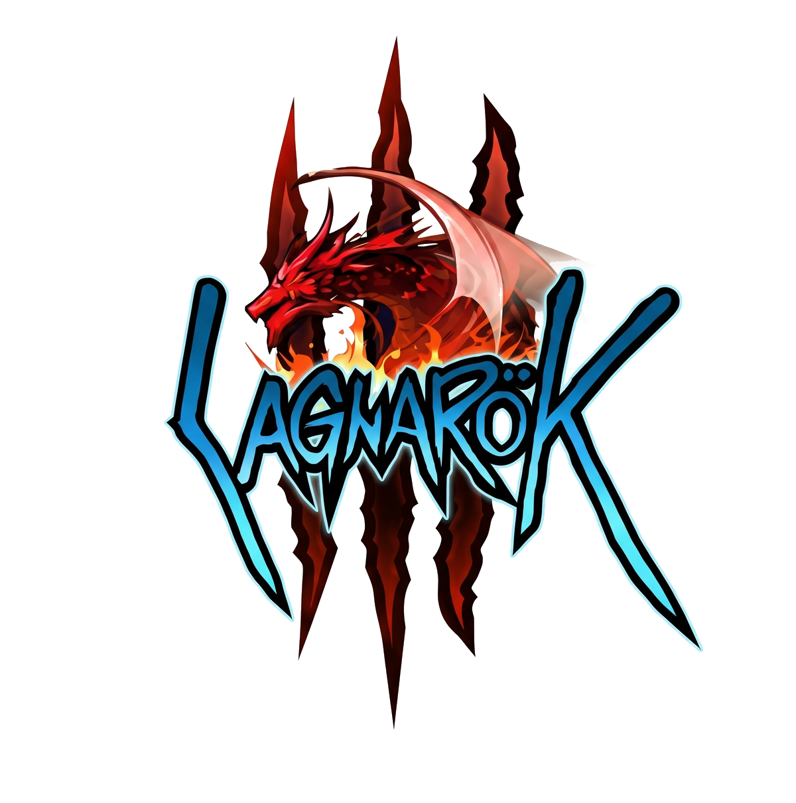

<p align="center">
  
</p>

<h1 align="center">LagnaroK (Lro3) — Cliente y Ecosistema</h1>
<p align="center">
  <b>Lanzador oficial de escritorio, cliente de PC y resumen del ecosistema de Ragnarok Online 3 (RO3)</b>
</p>

<p align="center">
  <a href="https://github.com/k3ldon/Lro3-Cliente/releases/latest"></a>
  
  
  
  <a href="https://github.com/k3ldon/Lro3"></a>
  <a href="https://cp.lagnarok.online/"></a>
  <a href="https://lagnarok.online/"></a>
</p>

---

## 🌟 ¿Qué es Lro3 y qué estamos creando?

**Lro3** (LagnaroK) es un proyecto de emulación autoritativa de nueva generación, ecosistema de servidor Linux para producción y cliente de PC optimizado para **Ragnarok Online 3 (RO3)**. 

Bifurcado y profundamente evolucionado a partir de la investigación comunitaria de `aethai/ro3emu-server`, nuestro objetivo es construir una experiencia de juego masiva, viva, fiel 1:1 al cliente global de Unity, completamente en español y adaptada a los estándares de rendimiento y calidad de los ordenadores de escritorio modernos.

El repositorio del servidor y código fuente de la plataforma se encuentra en [**k3ldon/Lro3**](https://github.com/k3ldon/Lro3). A continuación presentamos los grandes pilares de lo que estamos creando:

---

### 🛡️ Los 10 Grandes Ejes de Innovación de Lro3

```
┌──────────────────────────────────────────────────────────────────────────────────┐
│                             ECOSISTEMA LRO3 / LAGNAROK                           │
├───────────────────────┬──────────────────────────┬───────────────────────────────┤
│    MUNDO & COMBATE    │  INFRAESTRUCTURA & RED   │    EXPERIENCIA PC & CLIENTE   │
│                       │                          │                               │
│ • Bots Vivos & GvG    │ • ScenePartition 0-Alloc │ • URP Graphics Enhancer (F10) │
│ • 14 Raids Rehechas   │ • SQLite WAL 0.02ms p50  │ • 700+ Paletas con Preview 3D │
│ • 10+ Ciudades Vivas  │ • Anti-Cheat Autoritativo│ • Modo Clásico por Clic       │
│ • Fórmulas DEF/PvP 1:1│ • 2FA TOTP RFC 6238      │ • Launcher Zstd Multi-Parte   │
│ • CC & Ruptura Daño   │ • Panel Web en Next.js   │ • Español Nativo en Unity     │
└───────────────────────┴──────────────────────────┴───────────────────────────────┘
```

#### 1. Población Viva y Guerra de Gremios Simulada (`Ro3Emu.FakePlayers`)
- **Mundo Poblado**: Ciudades y campos llenos de aventureros autónomos que caminan, interactúan, realizan compras en tiendas de jugadores y dan vida al reino.
- **Acompañantes de Mazmorra**: Compañeros de grupo bots que acompañan al jugador en instancias privadas y le asisten en combate sin robar botín ni recompensas.
- **Guerra de Gremios Masiva (`!gvg`)**: Sistema de asedio simulado que puebla castillos con más de **140 bots de 3ra clase al nivel máximo**, operando cañones balísticos, máquinas de guerra y vehículos guardianes (tanques, Madogear, Peco Peco) en batallas épicas por el Emperium.

#### 2. Reconstrucción Cinemática 1:1 de Mazmorras de Historia y Raids
- **Raid Boss Trials (14 Jefes Oficiales)**: Reconstrucción autoritativa de 4 jefes de *Realm of the Gods* (Isti, Nasha, Ilmo, Mirko) y 10 raids de 5 jugadores (Orc Hero, Drake, Moonlight Flower, Golden Thief Bug, Mistress, Maya, Osiris, Pharaoh, Baphomet) con rotaciones cinemáticas oficiales, áreas de sombra telegrafificadas y mecánicas fieles al juego.
- **Combate de Dirigible Oficial (1000501)**: Artillería balística con retícula TPS desde el asiento de torreta, proyectiles físicos con tiempo de vuelo, barcos enemigos voladores en patrulla lejana, barriles rodantes e incendios en cubierta.
- **Aliados de Historia y Aleatorización**: Acompañantes aliados activos en combate (`CompanionUnit`) en Payon Forest y Alcantarillas, aleatorización Fisher-Yates de campanas en minijuegos de Louie (3120402 / 3120703) y expulsión limpia al mundo exterior tras victoria (`leavesAfterClear`).

#### 3. Ciudades Vivas con Misiones, Comercio y Lore Clásico (Opcode 31207 / `ActionConfig`)
- Despacho autoritativo de acciones de servidor (saltos de mapa, teletransporte, entrada/salida de mazmorras y entrega de tareas).
- Más de **50 NPCs interactivos con lore clásico**, boticas y misiones secundarias distribuidos en más de **10 ciudades y mazmorras**: Prontera, Izlude, Payon, Aldea de Arqueros, Morroc, Alberta, Geffen, Glast Heim, Amatsu, Tierras de Ultramar (Gonryun, Louyang, Ayothaya, Comodo Beach), Barco Hundido, Pirámides y Esfinge.

#### 4. Fórmulas de Combate Oficiales 1:1 y Control de Masas
- **Escalamiento de DEF**: Mitigación de daño físico de la defensa escalada autoritativamente contra el nivel del atacante (`DefenseFactor = k / (k + DEF)`).
- **Retroceso Físico (Knockback / Pull) en PvP**: Desplazamiento autoritativo (opcode 31112) con cálculo de colisiones sobre el NavGrid (`WalkableEnd`).
- **Cadencia con Jitter (`SwingInFlight`)**: Prevención de macros y spam de ataques sin violar la cadencia ASPD real del personaje.
- **Procs Oficiales de Cartas MVP y Pasivas**: Carta Baphomet (daño splash melee), Osiris, Pharaoh (Luz Divina reactiva), Doppelganger, Mistress (reinicio de cooldowns), Maya (reflejo de magia), y reacciones de clase (Parry, Devotion, Auto Counter, Reflect).
- **Control Universal de Monstruos**: Stun, Freeze, Petrify, Root, Silence, Sleep e Invincible con ruptura determinista por daño (`BreaksOnDamage`).

#### 5. Economía Dinámica y Servidor Sostenible
- **Patrones de Comercio Simulados**: `StallPatrons` y `AuctionPatrons` adquieren objetos en puestos de jugadores con deducción de impuestos y liquidación de dividendos en subastas desiertas.
- **Reparto Equitativo de Experiencia (`PartyExpShare`)**: Opción configurable de reparto de Base EXP en partes iguales entre miembros del grupo conectados en el mismo mapa.
- **Caducidad Autoritativa de Objetos**: Gestión de tiempo de vida de objetos temporales (`_iTimeBoundEnum`) y libro de contabilidad económico transaccional.

#### 6. Motor de Concurrencia Espacial y Rendimiento de Servidor
- **ScenePartition Concurrente**: Particionado independiente por escena que sustituye el semáforo global único, procesando movimientos y AoI en paralelo con cero contención y cero alocaciones Gen0 (benchmark verificado de 300 bots en Prontera).
- **SQLite con Escritor Asíncrono Dedicado**: Modo WAL (`journal_mode=WAL`), transacciones atómicas de snapshots de personaje en 0.02 ms p50 sin bloqueo de rol al desconectar.
- **Navegación A\* y Socket Expandido (4 MiB)**: Celdas de 1 metro con cálculo de clearance y caché de flood-fill (`NavReach`), y socket `PhonestChannel.MaxFrame = 4 MiB` para soportar mundos masivos sin fragmentación.

#### 7. Seguridad Integral, 2FA / TOTP y Anti-Cheat Autoritativo
- **Autenticación en Dos Pasos (2FA / TOTP RFC 6238)**: Integración en Servidor, Launcher y Panel Web con generación de QR en SVG nativo, claves Base32, validación en tiempo constante (`FixedTimeEquals`), códigos de rescate de un solo uso y protección contra replay attacks.
- **Anti-Cheat Autoritativo**: Validación presupuestaria de movimiento (`WalkCheck`, `WalkAllowance`) con snapback adaptativo, límite horizontal en vuelo 3D, restricción direccional de ataque (`WalkPoint`/`SwingTurnLeft`) y cubos de fichas (`RateBucket`) para frenar inundaciones de paquetes en chat, habilidades e inventario.
- **Launcher-Only Gate**: El servidor rechaza credenciales nativas directas de Unity, requiriendo códigos temporales de un solo uso emitidos por el lanzador autenticado.

#### 8. Localización Limpia y Selector "Español" Nativo en Unity
- **Zero-Stomp Guarantee**: El idioma inglés oficial no se contamina ni se sobreescribe.
- **Canal en Español Completo**: Traducción profunda de interfaces, habilidades, misiones, diálogos y descripciones mediante `es_overrides.tsv` y `translations_es/`, con 100% de cobertura y 0 textos faltantes.
- **Selector In-Game**: Integración en el motor de Unity (`LanguageHook.cs`) permitiendo alternar entre Español e Inglés directamente desde el menú nativo de `Ajustes -> Idioma del sistema` en el cliente de PC.

#### 9. Fidelidad de Cliente y Parches IL (Release `official-140085-r5`)
- Solución al problema de colisión de basenames en el recovery manifest oficial firmado con RSA (`HappyEngine.Resource.dll`), implementando un parche IL en publish time (`DisambiguateLegacyBasenames`) que preserva la integridad criptográfica oficial sin requerir alteraciones al manifest firmado.

#### 10. Panel de Control Web Corporativo ([cp.lagnarok.online](https://cp.lagnarok.online))
- Aplicación web desarrollada en Next.js con diseño corporativo, monitor de rates y jugadores en vivo, conmutación instantánea de modo mantenimiento sin reinicio (0 ms), editor de ajustes autoritativos del servidor (`/admin/servidor`), monitor de reinicio de servicio con captura de logs y portal de seguridad de cuenta.

---

## 🚀 Comparativa Resumida: Upstream (AethAI) vs. Lro3 (LagnaroK)

| Área / Sistema | Upstream (`aethai/ro3emu-server`) | Lro3 (`k3ldon/Lro3` + `Lro3-Cliente`) |
|---|---|---|
| **Idioma y Localización** | Inglés básico con textos en chino sin traducir. | **Español completo** con selector nativo en ajustes de Unity (`LanguageHook.cs`) y cero textos faltantes. |
| **Lanzador de Escritorio** | Consola básica o launcher mínimo de terceros. | **`RO3Launcher.exe` v1.2.27+**: descarga Full-Pack Zstandard multi-parte, HTTP Range resume y noticias en vivo. |
| **Seguridad de Acceso** | Login directo sin autenticación adicional. | **2FA / TOTP RFC 6238 nativo**, guardado DPAPI cifrado, códigos de rescate y launcher-only gate. |
| **Población y Gremios** | Sin bots o limitado a pruebas sintéticas. | **`Ro3Emu.FakePlayers`**: bots en ciudades, compañeros de mazmorra y **GvG simulado (`!gvg`)** con 140+ bots y artillería. |
| **Economía de Servidor** | Dependiente 100% de jugadores reales. | **`StallPatrons` y `AuctionPatrons`**: compras simuladas en puestos de jugadores, subastas activas y `PartyExpShare`. |
| **Rendimiento de Escena** | Semáforo global único (`_aoiDispatch`). | **`ScenePartition` concurrente**: 0 alocaciones Gen0, socket de 4 MiB y Prontera Líneas 1 y 2 en paralelo. |
| **Combate y Raids** | Reglas básicas y encuentros incompletos. | **Fórmulas 1:1**, PvP Knockback físico, 14 raids de jefes (`RaidBossTrials`), combate en Dirigible y cartas MVP. |
| **Mundo y Exploración** | NPCs estáticos sin interacción. | **Despacho de acciones (Opcode 31207)** con NPCs interactivos, lore y misiones en más de 10 ciudades. |
| **Gráficos en PC** | Calidad móvil estándar de Unity. | **Potenciador Gráfico URP en tiempo real (F10 / `/gfx`)**: sombras 4K, mallas LODX, SMAA + FSR RCAS y SSR. |
| **Personalización** | Tintes básicos limitados. | **NPC Alba en Prontera**: más de 700 paletas de ropa Kamishi con **vista previa 3D in-game interactiva**. |

---

## 📥 Descargas Oficiales del Cliente

El cliente de escritorio de LagnaroK se distribuye para Windows de 64 bits en dos formatos:

| Tipo | Archivo | Tamaño | Enlace de Descarga |
| :--- | :--- | :--- | :--- |
| **Instalador de Windows (Recomendado)** | `LagnaroK-Setup.msi` | ~66 MB | [**Descargar Instalador MSI**](https://github.com/k3ldon/Lro3-Cliente/releases/latest/download/LagnaroK-Setup.msi) |
| **Ejecutable Portable Directo** | `RO3Launcher.exe` | ~72 MB | [**Descargar RO3Launcher.exe**](https://github.com/k3ldon/Lro3-Cliente/releases/latest/download/RO3Launcher.exe) |

> 💡 **Nota**: También puedes descargar versiones previas o específicas desde la sección de [GitHub Releases](https://github.com/k3ldon/Lro3-Cliente/releases). El archivo `RO3Launcher.exe` se encuentra además trackeado en la raíz de este repositorio mediante **Git LFS**.

---

## 🌟 Características Destacadas del Lanzador (`RO3Launcher.exe`)

- **Descarga Ultrarrápida Full-Pack**: Descarga inicial en 16 partes multi-gigabyte comprimidas con Zstandard (`zstd`) sobre CDN Cloudflare con edge caching inmutable (`ro3.lagnarok.online`).
- **Resiliencia HTTP Range**: Si se produce un corte en la conexión, reanuda desde el último byte descargado con hasta 10 reintentos automáticos.
- **Staging Inteligente y Descarga Delta**: Comprueba los archivos locales y solo descarga las diferencias por chunks individuales.
- **Autenticación Segura y 2FA / TOTP**: Compatible con Google Authenticator, Microsoft Authenticator y Aegis, con guardado cifrado en Windows DPAPI (`CurrentUser`).
- **Auto-Actualización Silenciosa y Hot-Update**: Auto-actualización del propio launcher desde GitHub Releases y actualización transparente de librerías del cliente (`Ro3Emu.ClientHooks.dll` y `Ro3Emu.Loc.dll`).
- **Noticias y Avisos en Vivo**: Feed de noticias sincronizado en tiempo real con el [Panel de Control](https://cp.lagnarok.online).
- **Detección Reactiva de Mantenimiento**: Si el servidor está en mantenimiento, el launcher avisa claramente en ámbar y desactiva el botón de jugar, eliminando falsos errores de contraseña.

---

## 🎮 Mejoras de Jugabilidad en PC (En el Juego)

- **Potenciador Gráfico URP (Tecla `F10` o `/gfx`)**: Desbloquea mallas de alto detalle (LODX), sombras solares 4K con 4 cascadas, antialiasing SMAA High + FSR RCAS sharpening, filtrado anisotrópico 16x y reflejos en espacio de pantalla (SSR).
- **Estilista con 700+ Paletas Kamishi**: Habla con el NPC Alba (`90000002`) en la plaza de Prontera para probarte más de 700 combinaciones de colores clásicas con vista previa 3D en tiempo real.
- **Modo PC Clásico**: Desplazamiento por clic izquierdo sobre el suelo con marcador visual de ruta (*Path GFX*) y rotación libre con clic derecho.
- **Hotbar PC de 9 Casillas**: Ranuras ampliadas 7, 8 y 9 dedicadas para habilidades activas y consumibles.
- **Zoom Táctico (+30%)**: Mayor ángulo de visión que persiste entre cargas y cinemáticas.
- **Idioma Español Nativo**: Selecciona "Español" directamente en `Ajustes -> Idioma del sistema` en el juego.

---

## 🚀 Guía de Inicio Rápido

1. **Instalación**: Ejecuta [**`LagnaroK-Setup.msi`**](https://github.com/k3ldon/Lro3-Cliente/releases/latest/download/LagnaroK-Setup.msi) o descarga [**`RO3Launcher.exe`**](https://github.com/k3ldon/Lro3-Cliente/releases/latest/download/RO3Launcher.exe) en una carpeta dedicada (ej. `D:\Lagnarok\`).
2. **Cuenta de Juego**: Regístrate gratuitamente en [lagnarok.online](https://lagnarok.online) o en el [Panel de Control](https://cp.lagnarok.online).
3. **Inicio de Sesión**: Abre el lanzador, introduce tus credenciales (y código 2FA si está activo).
4. **Descarga**: Deja que el launcher descargue y ensamble automáticamente los archivos oficiales del juego (~24 GB).
5. **¡A jugar!**: Haz clic en **"JUGAR"** para adentrarte en el mundo de Midgard.

---

## 💻 Requisitos del Sistema

| Componente | Requisitos Mínimos | Requisitos Recomendados |
| :--- | :--- | :--- |
| **Sistema Operativo** | Windows 10 (64 bits, v1909+) | Windows 10 / 11 (64 bits, última versión) |
| **Procesador (CPU)** | Intel Core i3 (4ª gen) / AMD FX-6300 | Intel Core i5 (8ª gen+) / AMD Ryzen 5 |
| **Memoria (RAM)** | 8 GB de memoria RAM | 16 GB de memoria RAM de doble canal |
| **Tarjeta Gráfica (GPU)** | Intel HD Graphics 530 / NVIDIA GT 730 | NVIDIA GTX 1060 / AMD RX 580 o superior (para modo URP Ultra) |
| **DirectX** | Versión 11 compatible | Versión 11 o 12 |
| **Almacenamiento** | 30 GB de espacio libre | 35 GB de espacio libre en unidad de estado sólido (**SSD**) |
| **Conexión a Internet** | Conexión de banda ancha | Conexión de fibra óptica de baja latencia |

---

## 🔗 Enlaces Oficiales del Ecosistema

- 📦 **Repositorio del Servidor (Lro3)**: [https://github.com/k3ldon/Lro3](https://github.com/k3ldon/Lro3)
- 💻 **Repositorio del Cliente (Lro3-Cliente)**: [https://github.com/k3ldon/Lro3-Cliente](https://github.com/k3ldon/Lro3-Cliente)
- 🌐 **Sitio Web Oficial**: [https://lagnarok.online](https://lagnarok.online)
- 📊 **Panel de Control y Base de Datos**: [https://cp.lagnarok.online](https://cp.lagnarok.online)
- 🛡️ **Seguridad de Cuenta y 2FA**: [https://cp.lagnarok.online/account/security](https://cp.lagnarok.online/account/security)

---

## ⚖️ Licencia y Descargo de Responsabilidad

Este software se proporciona bajo la licencia de código abierto **GNU General Public License v3.0** ([GPL-3.0](https://www.gnu.org/licenses/gpl-3.0.html)).

*LagnaroK y RO3Launcher son desarrollos comunitarios independientes orientados a la investigación, preservación y entretenimiento. Ragnarok Online y Ragnarok Online 3 son marcas registradas de Gravity Co., Ltd. Este proyecto no está respaldado, patrocinado ni asociado comercialmente con Gravity Co., Ltd. ni con sus asociados editoriales. El software no distribuye ni aloja archivos con derechos de autor protegidos del cliente oficial.*
